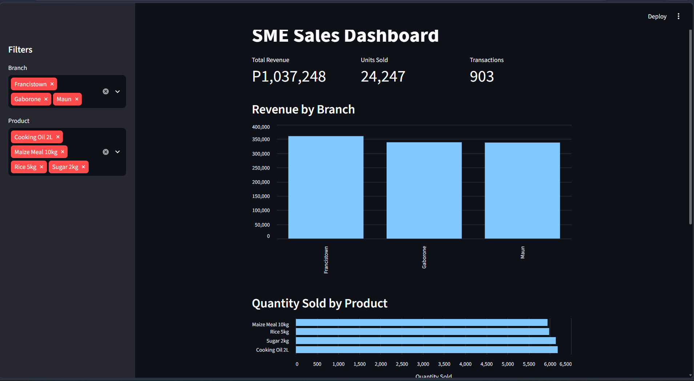

## SME SALES DASHBOARD

This project helps small business owners in Botswana understand their sales data without going through messy spreadsheets. It is an interactive dashboard that shows total revenue, units sold, revenue by branch, which products sell the most and least, and revenue by month, with filters for branch and product.

Next, I plan to add stock-level tracking and profit reporting.

This project is part of my 90-day Python learning plan.



## What it does

- Shows total revenue, units sold and number of transactions as summary cards
- Compares revenue across branches (Gaborone, Francistown, Maun)
- Shows which products sell the most and the least
- Tracks revenue month by month
- Lets you filter everything by branch and product from the sidebar

## Tech used

- **Python** for all the logic
- **pandas** for loading, cleaning and aggregating the sales data
- **Streamlit** for the interactive web dashboard
- **Altair** for the sorted product and monthly charts inside the dashboard
- **matplotlib / seaborn** for static chart exports during analysis

## Project structure

```
sme-dashboard/
├── app.py                  # Streamlit dashboard
├── notebooks/
│   ├── explore.py          # Data loading and analysis functions
│   └── generate_data.py    # Creates sample sales data
├── data/
│   └── sales.csv           # Sales records
├── docs/
│   └── dashboard.png       # Screenshot used in this README
└── requirements.txt        # Python dependencies
```

## How to run it

1. Clone the repository and move into it:
```bash
   git clone https://github.com/justsircole/sme-dashboard.git
   cd sme-dashboard
```
2. Create and activate a virtual environment (Git Bash on Windows):
```bash
   python -m venv venv
   source venv/Scripts/activate
```
3. Install the dependencies:
```bash
   pip install -r requirements.txt
```
4. Start the dashboard:
```bash
   streamlit run app.py
```
5. Open `http://localhost:8501` in your browser.

## About the data

The data in `data/sales.csv` is **synthetic**. It was generated by `notebooks/generate_data.py` and covers April to July 2026 for three branches and four products. Because quantities are random, the differences between branches and months are small. The dashboard is built to work with real sales records in the same format:

| date | branch | product | quantity_sold | price |
|------|--------|---------|---------------|-------|

## What I learned

- Structuring analysis as reusable functions so the same code feeds both scripts and the dashboard
- Aggregating data with pandas (`groupby`, filtering with boolean masks)
- Building interactive filters and summary cards in Streamlit
- Debugging environment problems, including a Windows security policy that blocked matplotlib's chart engine, which I solved by switching to Streamlit's built-in charts

## Next steps

- Replace the sample data with real sales records
- Add a date-range filter
- Deploy the dashboard online

## Author

Kim Seakolo · https://www.linkedin.com/in/kim-seakolo-943351345/